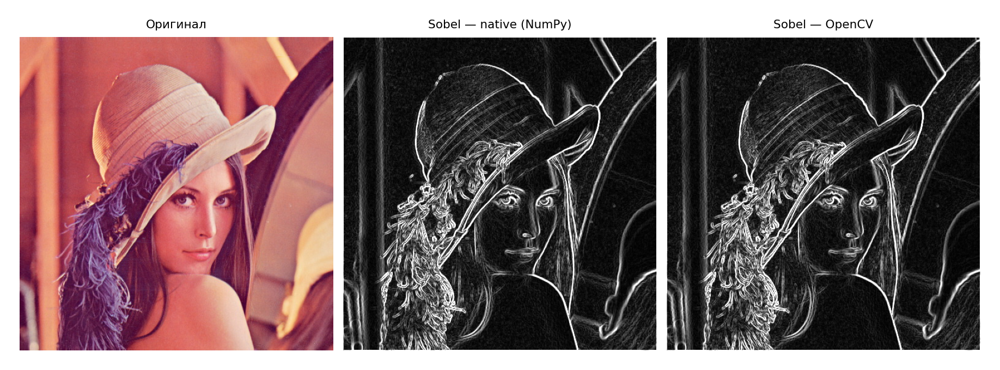
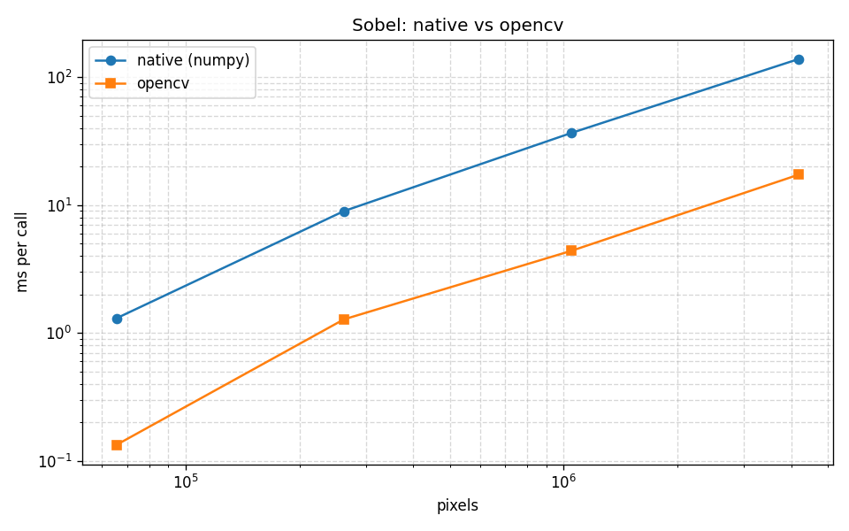

# Лабораторная работа №1. Морфологическая дилатация

**Студент:** Рыцев Максим Георгиевич  
**Университет:** ИТМО, 4 курс, СППО  
**Преподаватель:** Денисов Алексей Константинович  
**Вариант:** 6 — дилатация, примитив 3×3

## 1. Теоретическая база

Дилатация — базовая операция математической морфологии над бинарными
изображениями. Применяется для роста светлых областей, заполнения мелких
тёмных разрывов и трещин, соединения близких объектов.

Формально дилатация бинарного изображения `A` структурирующим элементом
`B` определяется как множество всех точек `z`, при которых сдвинутый
элемент `B_z` пересекается с `A`:

```
A ⊕ B = { z | (B_z ∩ A) ≠ ∅ }
```

Для примитива 3×3 (полный квадрат из единиц) это эквивалентно операции
«максимум по окрестности 3×3» для каждого пикселя:

```
dst(x, y) = max { src(x + i, y + j) | i, j ∈ [-1, 0, 1] }
```

Примитив 3×3:

```
1 1 1
1 1 1
1 1 1
```

Свойства, важные для работы:

- дилатация — двойственная операция к эрозии (`dilate(A, B)` =
  `¬erode(¬A, B)`);
- дилатация ассоциативна по примитиву: `dilate(dilate(A, B1), B2)` =
  `dilate(A, B1 ⊕ B2)`;
- за одну итерацию с примитивом 3×3 светлые области расширяются ровно
  на 1 пиксель во все стороны (по метрике Чебышёва).

Границы изображения в работе обрабатываются нулевым padding'ом
(`BORDER_CONSTANT`), чтобы native и OpenCV давали одинаковый результат
на всей площади кадра.

Бинаризация (по условию задания реализовывать вручную не требуется)
выполняется через `cv2.threshold` с методом Оцу — порог подбирается
автоматически по гистограмме.

## 2. Описание разработанной системы

Проект состоит из четырёх модулей в `src/`:

- `dilation_native.py` — нативная реализация на NumPy. Считает
  поэлементный максимум по девяти сдвинутым срезам padded-массива
  через `np.maximum(..., out=...)` (без промежуточных копий).
- `dilation_opencv.py` — реализация через `cv2.dilate` с примитивом 3×3
  из единиц.
- `benchmark.py` — утилита замера: warmup 3 итерации, затем до 0.5 с
  суммарно (или до 200 итераций), возвращает mean/std в секундах и число
  итераций.
- `main.py` — точка входа: загрузка, бинаризация (Otsu), проверка
  совпадения native и OpenCV, визуализация, прогон бенчмарка на размерах
  256/512/1024/2048, запись `benchmark.csv` и графика.

Алгоритм native-реализации:

1. Padding на 1 пиксель нулями по каждой стороне.
2. Девять срезов `padded[i:i+h, j:j+w]`, `i, j ∈ {0,1,2}`.
3. Поочерёдное `np.maximum(out, slice, out=out)` — накопление максимума
   в один буфер, без создания новых массивов.
4. Возврат `uint8`-массива той же формы, что входной.

Алгоритм OpenCV-реализации по смыслу тот же, но сам шаг максимума
выполняет `cv2.dilate`, внутри которого для бинарных `uint8`-изображений
задействована оптимизация по битовым плоскостям и SIMD.

Структура проекта:

```
itmo-image-processing-lab1/
├── src/
│   ├── dilation_native.py
│   ├── dilation_opencv.py
│   ├── benchmark.py
│   └── main.py
├── data/input/test_image.png
├── results/
│   ├── benchmark.csv
│   └── images/
│       ├── comparison.png
│       ├── benchmark.png
│       ├── binary.png
│       ├── native.png
│       └── opencv.png
├── requirements.txt
└── README.md
```

Запуск:

```
pip install -r requirements.txt
python src/main.py
```

## 3. Результаты работы и тестирования системы

### Корректность

Бинаризация по Оцу, затем дилатация примитивом 3×3. Сравнение native
и OpenCV на тестовом изображении:

| метрика   | значение |
|-----------|----------|
| max_diff  | 0        |
| mean_diff | 0.0      |
| equal_pct | 100.0 %  |

Обе реализации совпадают бит-в-бит: дилатация на бинарном изображении
не использует арифметики (только `max`), поэтому расхождения по
округлению невозможны — в отличие от свёрточных фильтров, где native
и OpenCV могут разойтись на 1–2 уровня `uint8`.

Визуализация (оригинал / Otsu / native / OpenCV):



На изображении видно, что светлые области (объекты, попавшие в
бинаризацию как «белое») расширились на 1 пиксель по всем направлениям,
мелкие тёмные проколы внутри объектов заполнились.

### Быстродействие

Замер: warmup 3 итерации, затем до 0.5 с суммарно, mean/std по числу
итераций. Размеры квадратные, бинарное изображение ресайзится из
исходного методом `INTER_NEAREST` (чтобы не размывать бинарную маску).

| Размер    | Native, мс | OpenCV, мс | Ускорение |
|-----------|-----------:|-----------:|----------:|
| 256x256   |       0.06 |       0.01 |      4.3x |
| 512x512   |       0.14 |       0.04 |      3.5x |
| 1024x1024 |       0.90 |       0.35 |      2.6x |
| 2048x2048 |       4.98 |       0.83 |      6.0x |

Полные данные с std и числом итераций — [`results/benchmark.csv`](results/benchmark.csv).



Закономерность: время обеих реализаций растёт линейно по числу пикселей.
При переходе 256→2048 (в 16 раз по количеству пикселей) native растёт
примерно в 77 раз, OpenCV — в 56 раз; для малых размеров заметную роль
играет фиксированный overhead вызова. Ускорение OpenCV по диапазону
варьируется от 2.6× до 6.0× и немонотонно, что видно и по `std` в CSV.
Причины — комбинация трёх факторов: (1) на 2048×2048 native сделал
только 101 итерацию (упёрся в бюджет времени 0.5 с), поэтому mean/std
менее устойчивы; (2) на малых размерах у native относительно высокая
доля Python-overhead на каждый `np.maximum`-проход; (3) на средних
размерах (1024×1024) оба варианта попадают в L2/L3-кэш, и native с
`out=out` показывает лучший локальный результат. Тем не менее средний
разрыв по всем размерам — примерно 4× в пользу OpenCV, а на больших
размерах, где важна пропускная способность памяти, он растёт.

## 4. Выводы по работе

- Реализована морфологическая дилатация примитивом 3×3 в двух вариантах:
  нативная на NumPy и через `cv2.dilate`. Результаты совпадают полностью
  (`equal_pct = 100 %`), что для бинарной морфологии ожидаемо — операция
  не содержит арифметики с плавающей точкой и коммутативна.
- OpenCV быстрее нативной реализации в среднем в 4 раза (разброс по
  размерам — от 2.6× до 6.0×). Алгоритмическая сложность одинаковая
  (`O(H*W)`), разрыв объясняется константным фактором — бит-плоскостной
  оптимизацией и SIMD внутри `cv2.dilate` против девяти `np.maximum`-проходов
  поверх NumPy. Немонотонность ускорения — следствие cache-эффектов на
  средних размерах и шума замера на больших (там native сделал всего 101
  итерацию из-за лимита по времени).
- Native-реализация через накопление `np.maximum(..., out=out)` работает
  заметно быстрее наивного варианта с двойным циклом по пикселям.
- Границы изображения обрабатываются нулевым padding'ом, поэтому
  результат совпадает с `cv2.dilate` при `BORDER_CONSTANT`. Смена
  border-mode в OpenCV (`BORDER_REFLECT_101` по умолчанию) привела бы
  к расхождению на кайме.

## 5. Использованные источники

1. OpenCV documentation. Eroding and Dilating.
   https://docs.opencv.org/4.x/db/df6/tutorial_erosion_dilatation.html
2. OpenCV documentation. `cv::dilate`, `cv::getStructuringElement`.
   https://docs.opencv.org/4.x/d4/d86/group__imgproc__filter.html
3. OpenCV documentation. Thresholding Operations using `threshold`.
   https://docs.opencv.org/4.x/d7/d4d/tutorial_py_thresholding.html
4. Gonzalez R. C., Woods R. E. Digital Image Processing. 4th ed. —
   Pearson, 2018. — Гл. 9 «Morphological Image Processing».
5. NumPy documentation. `numpy.maximum`, `numpy.pad`.
   https://numpy.org/doc/stable/reference/generated/numpy.maximum.html